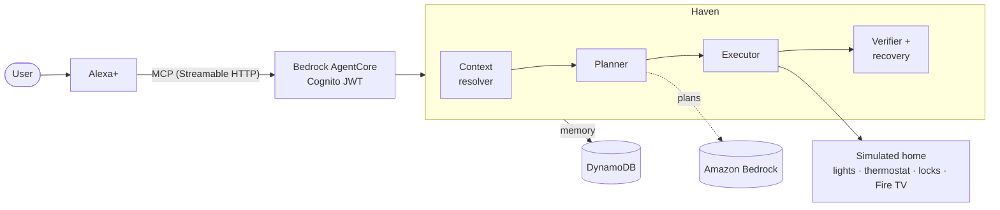

# Haven

**A household agent for Alexa+ that understands what the home is trying to do,
makes a plan, acts, and checks its work.**

> Smart homes understand commands. Haven understands situations.


*Haven's dashboard after "We're leaving the house" is confirmed: eight steps ran,
and Haven re-read the home to verify each one. (Rendered from the real
components with real backend data; see [the demo](docs/demo.md#screenshots).)*

## What is Haven?

Say "we're leaving the house" and a normal smart home needs eight separate
commands. Haven takes the *goal*: it works out who is home, what is on, and
what could go wrong; proposes a plan; **asks before doing anything it can't
easily undo**; runs it; then **re-reads the home to confirm each step really
took effect**, retrying once if a device didn't listen. If it can't plan
safely, it asks a question instead of guessing.

It is built for the Amazon Developer Hackathon: **Alexa+** is the interface,
Haven is an **MCP server** Alexa+ calls, and it runs on **AWS**.

## Three workflows

| Say | Haven does | Asks first? |
|---|---|---|
| "Get movie night ready" | Picks a film that fits the free time, queues it on the TV, dims the lights, verifies | No — all reversible |
| "We're leaving the house" | Lights off, stops the TV, thermostat to away, locks both doors, arms security, verifies each | **Yes** — locking and arming |
| "What should we do tonight?" | Suggests options from the calendar, saved tastes and recent activity | No — suggestions only |

## How it works



1. **Context** — gathers only what the goal needs, from approved sources
   (what you said, the calendar, device state, simple sensors, saved
   preferences). It asks rather than guesses.
2. **Plan** — deterministic code applies hard constraints (time, availability,
   capabilities); the model, when enabled, only chooses and explains among
   what is left. Every step is labelled reversible or high-impact.
3. **Execute** — plain code, never the model. High-impact steps run only
   after explicit confirmation.
4. **Verify** — Haven reads the home back. A step that didn't take effect is
   retried once, then reported honestly.

More: [MCP interface](docs/mcp.md) · [Architecture](docs/architecture.md) ·
[Privacy](docs/privacy.md).

## Why these technologies

- **Alexa+** gives a natural-language front door, so the user states a goal and
  Haven turns it into actions.
- **MCP** is the contract: six small tools (context, propose, status,
  execute, save preference, recommend) that Alexa+ can call, with JSON
  Schemas in [`apps/alexa/schemas/`](apps/alexa/schemas).
- **Amazon Bedrock AgentCore** hosts the MCP server (stateless Streamable
  HTTP) behind a Cognito JWT authorizer.
- **Amazon Bedrock (via Strands Agents)** does the planning when
  `HAVEN_PLANNER_BACKEND=bedrock`; a deterministic mock planner is the offline
  default and is what the tests use.
- **DynamoDB** stores preferences, remembered activity and proposed plans
  (`HavenPreferences`, `HavenActivities`, `HavenPlans`), reached through
  least-privilege IAM policies in [`aws/iam/policies/`](aws/iam/policies).

See [AWS](docs/aws.md) and [Deployment](docs/deployment.md) for the cloud side.

## Try it (offline, no AWS account)

Requires Python 3.11+.

```bash
pip install -e ".[dev]"

pytest                               # the full offline test suite
python scripts/run_movie_night.py    # context → plan → execute → verify, narrated
python scripts/verify_demo.py        # rehearse every beat of the demo
```

Run the server and the dashboard:

```bash
python scripts/run_server.py --dashboard-api     # MCP at http://127.0.0.1:8787/mcp
cd apps/dashboard && npm install && npm run dev  # http://localhost:5173
```

Point the [MCP Inspector](https://github.com/modelcontextprotocol/inspector)
(`npx @modelcontextprotocol/inspector`) at `http://127.0.0.1:8787/mcp`, call
`propose_household_plan_tool` with `goal: "we're leaving the house"`, then
`execute_household_plan_tool` with the returned `plan_id` — first without
`confirmed`, then with `confirmed: true` — and watch the dashboard.

To use it from Alexa+ see [`apps/alexa/README.md`](apps/alexa/README.md).

## Reproduce the demo

Follow [docs/demo.md](docs/demo.md): the three-minute script, the setup, the
fallbacks if something misbehaves, and the questions to expect.

## Configuration

Copy `.env.example` to `.env` (it is git-ignored). Everything defaults to
offline.

| Variable | Default | Purpose |
|---|---|---|
| `HAVEN_PLANNER_BACKEND` | `mock` | `mock` (offline, deterministic) or `bedrock` |
| `HAVEN_PERSISTENCE_BACKEND` | `memory` | `memory` or `dynamodb` |
| `HAVEN_MAX_PLAN_STEPS` | `12` | Safety cap on plan size |
| `HAVEN_LOG_LEVEL` | `INFO` | Log verbosity |
| `HAVEN_MCP_HOST` / `HAVEN_MCP_PORT` | `127.0.0.1` / `8787` | Where `run_server.py` binds |
| `HAVEN_DASHBOARD_API` | off | Serve the dashboard's read-only JSON (`--dashboard-api`) |
| `AWS_PROFILE`, `AWS_REGION` | — | Only for Bedrock / DynamoDB; standard credential chain, never committed |

Bedrock model settings are in `.env.example`.

## Repository tour

```
src/haven/
  context/        Context resolver: sources, facts, expiry
  planning/       Constraints, workflow recognition, plan service
  agents/         Planner, prompts, policies (reversible vs high-impact), Bedrock reasoner
  execution/      Deterministic action handlers and the executor
  verification/   Verifier and the recovery pass
  integrations/   Calendar, media, home, security (simulator-backed)
  memory/         Preferences and activity, in memory or DynamoDB
  mcp/            The MCP server, tools, schemas, dashboard API
aws/              Bedrock client, DynamoDB tables, IAM policies, AgentCore runtime
simulator/        The simulated home: household, media, security/devices
apps/alexa/       Alexa+ add-on config, tool catalog, JSON Schemas
apps/dashboard/   React dashboard (read-only)
scripts/          Server, demo rehearsal, submission check, schema export, tooling
tests/            unit · workflows · integration · fixtures
docs/             mcp · privacy · testing · demo · submission · friction log (+ AWS docs)
```

## Documentation

| | |
|---|---|
| [docs/mcp.md](docs/mcp.md) | Every tool, the plan lifecycle, confirmation and state |
| [docs/privacy.md](docs/privacy.md) | What Haven collects, remembers and refuses |
| [docs/testing.md](docs/testing.md) | Test layers, fixtures, failure scenarios, CI |
| [docs/demo.md](docs/demo.md) | The three-minute demo and how to reproduce it |
| [docs/architecture.md](docs/architecture.md) | How the pieces fit |
| [docs/aws.md](docs/aws.md) · [docs/deployment.md](docs/deployment.md) | The AWS services and how Haven is deployed |
| [docs/submission.md](docs/submission.md) | Hackathon submission text and product feedback |
| [docs/friction-log.md](docs/friction-log.md) | What was hard, per tool |
| [CONTRIBUTING.md](CONTRIBUTING.md) | Setup, style, how to add a tool or a workflow |

## Safety and privacy in one paragraph

Camera-free: Haven has no camera or microphone code. It gathers the minimum
context a goal needs, never turns temporary state (who is home, what is
locked) into memory, and asks instead of guessing. Locking and arming need
explicit confirmation, enforced by the planner, the executor and the tool.
The deployed runtime sits behind a Cognito JWT authorizer. Limits, stated
plainly: Haven trusts Alexa+ that the user really confirmed (it doesn't
identify the speaker), models one household, has no "forget this" tool yet,
and a local server has no authentication. Details in
[docs/privacy.md](docs/privacy.md).

## Status

What is built and tested: the three workflows end to end against a simulated
home, the MCP server and its six tools, confirmation gating, verification and
recovery, the dashboard, the AWS integrations, and the AgentCore runtime
behind Cognito. What is not confirmed: Alexa+ calling the deployed runtime
end to end (how Alexa+ presents the Cognito token, and the add-on manifest
format, were not checked against a live Alexa+ account), and the home is
simulated rather than real devices. See [the friction log](docs/friction-log.md).

## What's next

- Confirm the Alexa+ add-on manifest and token flow against a live account.
- Real Ring / Fire TV integrations behind the existing interfaces.
- Persist execution results alongside plans so status survives across instances.
- A "forget this" tool, and expiry on stored history.
- Per-person authorization for confirmations.
- Proactive suggestions ("it's Friday and everyone's home — movie night?").

## Contributing

Issues and pull requests are welcome; see [CONTRIBUTING.md](CONTRIBUTING.md).
Haven is licensed under the [Apache License 2.0](LICENSE).
