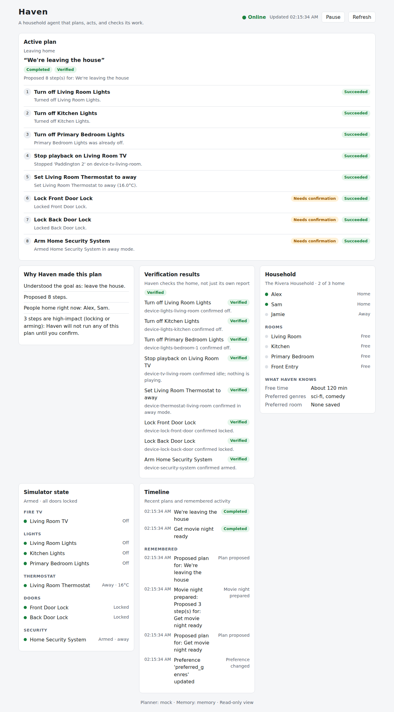

# The demo

A three-minute story: **smart homes execute commands; Haven understands what
the household is trying to do, makes a plan, acts, and checks its work.**
This page is the script, the setup, and the fallbacks. Rehearse it with
`python scripts/verify_demo.py` before you record.



## The one-sentence pitch

> Smart homes understand commands. Haven understands situations.

## Timeline (under three minutes)

| Time | Scene | Show | Say |
|---|---|---|---|
| 0:00 – 0:15 | **The problem** | Title card, then the idle dashboard | "Today a smart home runs commands. It doesn't know what the household is trying to do — or whether the command actually worked." |
| 0:15 – 0:30 | **Haven** | The architecture diagram from the README | "Haven turns Alexa+ into a household agent. It plans, acts, and verifies. Alexa+ talks to it over MCP." |
| 0:30 – 1:05 | **Movie night** | Alexa+ simulator, dashboard beside it | "Alexa, get movie night ready." → Haven proposes three steps, runs them. Point at: the film chosen to *fit the free time*, the dimmed lights, **Verification: Verified** |
| 1:05 – 1:50 | **Leaving home** | Alexa+ simulator, dashboard | "We're leaving." → eight steps, and *"I need your OK to lock the doors and arm security."* Say "Yes." → everything flips to Succeeded; verification re-reads the doors. Point at **Why Haven made this plan** |
| 1:50 – 2:15 | **When it goes wrong** | Dashboard, partial result | A door is offline. Haven retried, finished everything else, and told the truth: *which* door, and that it is not locked. "It doesn't claim success it can't prove." |
| 2:15 – 2:35 | **How it's built** | README diagram, AWS console tab optional | "Alexa+ → MCP → Amazon Bedrock AgentCore, behind Cognito → Haven → Bedrock for planning, DynamoDB for memory. Deterministic code does the acting; the model only plans." |
| 2:35 – 2:50 | **Privacy & open source** | `docs/privacy.md`, the repo | "Camera-free. It gathers only what the goal needs, asks instead of guessing, and never stores temporary state. Apache-2.0, on GitHub." |
| 2:50 – 2:58 | **Close** | Title card | "Haven doesn't just answer commands. It understands the household, makes a plan, acts, and verifies." |

The timeline is checked by `verify_submission.py` (it must fit 3:00 with no
overlaps), so keep the `m:ss – m:ss` format if you edit it.

## What the judges should see

| Criterion | The moment that shows it |
|---|---|
| **Technology** | A real MCP server over Streamable HTTP on AgentCore; the confirmation gate; verification catching a lie |
| **Design** | One goal, not a menu of device commands; the dashboard explains *why* |
| **Impact** | Leaving home: one sentence replaces eight actions, with a safety check |
| **Idea** | "Understands situations, not commands" — and says so honestly when it can't |

## Before you record

Run through this once, in order.

```bash
# 1. The demo's claims still hold
python scripts/verify_demo.py

# 2. The full suite and lint are green
pytest && ruff check src aws simulator tests scripts

# 3. The submission is in order
python scripts/verify_submission.py

# 4. Start Haven with the dashboard's read-only API
python scripts/run_server.py --dashboard-api

# 5. In another terminal, the dashboard
cd apps/dashboard && npm install && npm run dev      # http://localhost:5173
```

Then expose the server to Alexa+ with a tunnel (`ngrok http 8787`) and put
that URL into the Alexa+ console as described in
[`apps/alexa/README.md`](../apps/alexa/README.md).

Checklist:

- [ ] The dashboard shows **Online** and an empty "Active plan"
- [ ] The Alexa+ simulator can call a tool (try "what should we do tonight")
- [ ] Planner is the one you intend (`mock` is deterministic and offline —
      best for a take you must get right; `bedrock` shows the real model)
- [ ] Screen resolution readable at 1080p; notifications off; browser zoom ~110 %
- [ ] Restart the server between takes — state is in memory, so a restart is a
      clean household

### Demo state and the dashboard's exposure

The dashboard's API must run in the **same process** Alexa+ drives, which means
it is reachable through the tunnel for as long as it runs. That is acceptable
here only because the household is a **simulation with made-up names**.
Use a throwaway tunnel URL, stop the server when you finish, and never do this
with a real household ([privacy.md](privacy.md#access-and-exposure)).

### Making the "partial failure" scene

The dashboard is read-only, so take a door offline from code, in the running
server's process — the simplest way is to record that scene from a separate
take using the rehearsal, which does exactly this:

```bash
python scripts/verify_demo.py --dump-snapshots build/demo
```

and show `build/demo/05-partial-failure.json` rendered by the dashboard, or
the screenshot in [`images/`](images/05-partial-failure.png). If you want it
live, use the MCP Inspector against the server and call
`execute_household_plan_tool` after marking a device offline in a Python
shell attached to the same process.

## Fallbacks

| If… | Do this |
|---|---|
| The Alexa+ simulator is down or flaky | Drive the same tools from the **MCP Inspector** (`npx @modelcontextprotocol/inspector` → `http://127.0.0.1:8787/mcp`) with the dashboard beside it. Say so on camera. |
| Alexa+ can't reach the tunnel | Check the tunnel URL in the console; `curl <tunnel>/api/health` should answer `{"status":"ok"…}` when the dashboard API is on |
| Bedrock is slow or throttled | Set `HAVEN_PLANNER_BACKEND=mock` and restart; the mock planner is deterministic |
| The dashboard shows "Offline" | The server isn't running with `--dashboard-api`, or the proxy target is wrong (`VITE_HAVEN_PROXY_TARGET`) |
| A take goes wrong | Restart the server (fresh household) and re-record; nothing persists locally |

## Questions you'll be asked

Answer plainly; the limits are in the docs and it is better you say them first.

- **"Is the home real?"** No — it is simulated (lights, thermostat, locks, a
  Fire TV session). The integrations sit behind small interfaces a real hub
  would replace.
- **"What does the model do?"** Only planning, and only when
  `HAVEN_PLANNER_BACKEND=bedrock`. Constraints, execution and verification are
  ordinary deterministic code.
- **"What stops it locking me out?"** Locking and arming are high-impact:
  the planner marks them, and the executor refuses to run them without a
  confirmation. Caveat: `confirmed` is set by the client (Alexa+); Haven does
  not identify the speaker ([privacy.md](privacy.md#what-haven-does-not-do)).
- **"What if a device lies?"** That is what verification is for: Haven re-reads
  the home after acting and tries once more before reporting it.
- **"Is it deployed?"** The AgentCore runtime is deployed behind a Cognito
  JWT authorizer ([`aws/agentcore/config/README.md`](../aws/agentcore/config/README.md));
  whether Alexa+ can call it end to end is the one piece not yet confirmed
  against a live Alexa+ account.

## Screenshots

The images in [`docs/images/`](images) are the dashboard's real components,
rendered with real backend data from `scripts/verify_demo.py
--dump-snapshots` — they are not captures of a live Alexa+ session.

| File | Moment |
|---|---|
| `01-idle.png` | A quiet household, no plan yet |
| `02-movie-night.png` | Movie night: three steps, verified, film queued |
| `03-leaving-awaiting-confirmation.png` | Leaving home, waiting for a "yes" |
| `04-leaving-verified.png` | After "yes": locked, armed, verified |
| `05-partial-failure.png` | A door that did not respond, reported honestly |
| `06-clarification.png` | Haven asks instead of guessing |
