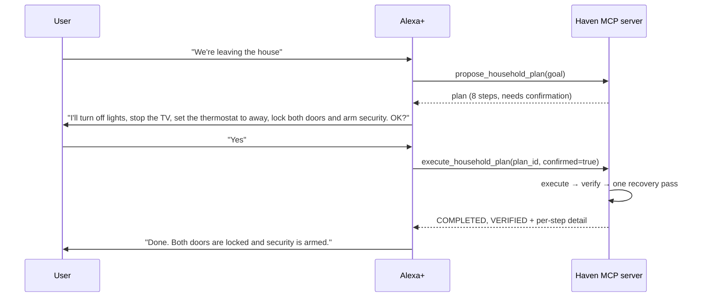

# Haven's MCP interface

Haven is an [MCP](https://modelcontextprotocol.io) server. Alexa+ (or any MCP
client) talks to it over **Streamable HTTP**; everything it can do is one of
six tools. This page is the reference for those tools, how a plan moves
through them, and how to extend or test the server.



## Connecting

| | Local | Deployed (AgentCore) |
|---|---|---|
| Start | `python scripts/run_server.py` | `aws/agentcore/runtime.py` in the container |
| URL | `http://127.0.0.1:8787/mcp` | the AgentCore runtime URL (see `aws/agentcore/config/README.md`) |
| Transport | Streamable HTTP (`--transport stdio` for local tools) | stateless Streamable HTTP on `0.0.0.0:8000/mcp` |
| Auth | none — keep it on a private machine or tunnel | `Authorization: Bearer <Cognito JWT>`, enforced by AgentCore before Haven runs |
| Planner / memory | `mock` / in-memory by default | `bedrock` / DynamoDB |

`scripts/run_server.py` reads `HAVEN_MCP_HOST` and `HAVEN_MCP_PORT`
(defaults `127.0.0.1`, `8787`); flags override them. Haven's code does no
authentication itself — see [privacy.md](privacy.md) and
[`apps/alexa/README.md`](../apps/alexa/README.md#authentication).

## The tools

Names are what a client sees (`tools/list`). Parameters marked **optional**
have real defaults, so a client may omit them.

| Tool | Changes the home? | Parameters | Returns |
|---|---|---|---|
| `get_household_context_tool` | No | `goal` | `HouseholdContextSummary` |
| `propose_household_plan_tool` | No | `goal` | `PlanSummary` |
| `get_plan_status_tool` | No | `plan_id` | `PlanStatusSummary` |
| `execute_household_plan_tool` | **Yes** | `plan_id`, `confirmed` (optional, default `false`) | `ExecutionSummary` |
| `save_household_preference_tool` | Memory only | `key`, `value`, `person_id` (optional) | `PreferenceSummary` |
| `get_activity_recommendations_tool` | No | `goal` (optional) | `RecommendationsResponse` |

Only `execute_household_plan_tool` ever touches a device. Everything else
reads, plans, or saves an explicit preference.

The JSON Schema for every request and response is in
[`apps/alexa/schemas/`](../apps/alexa/schemas) (generated from
`src/haven/mcp/schemas.py` by `python scripts/export_mcp_schemas.py`), and
[`apps/alexa/config/tool_catalog.json`](../apps/alexa/config/tool_catalog.json)
has example utterances for each tool.

### `get_household_context_tool(goal)`

Resolves what Haven currently knows for `goal`: who is home, rooms, devices
(with whether each is available), the media catalog, free minutes from the
calendar, and saved preferences. Context is gathered **for the goal only**
from approved sources — see [privacy.md](privacy.md). Returns
`household_id`, `people[]`, `rooms[]`, `devices[]`, `media_options[]`,
`available_minutes` (or `null`), `preferred_room_id`, `preferred_genres[]`.

### `propose_household_plan_tool(goal)`

Resolves context and asks the planner for a structured, policy-checked
plan. **Nothing is executed.** Haven recognises three workflows from the
goal (a deterministic keyword table, not a model call):

| Workflow | Examples | What the plan does |
|---|---|---|
| Movie night | "get movie night ready" | Picks a film that fits the free time, queues it on the TV, dims the lights |
| Leaving home | "we're leaving", "heading out", "lock up" | Lights off, stop the TV, thermostat to away, lock doors, arm security |
| Tonight | "what should we do tonight" | Suggestions only: review the evening, a film, a wind-down |

Response fields: `plan_id`, `goal`, `status` (`PROPOSED` or
`AWAITING_CONFIRMATION`), `requires_confirmation`, `summary`, `steps[]`
(`id`, `order`, `title`, `description`, `risk`, `requires_confirmation`),
plus `clarification_needed` / `clarification_prompt`.

A real response for "We're leaving the house" (trimmed to three of its
eight steps):

```json
{
  "plan_id": "plan-3f18030d-a99a-4443-b8f3-5caf1e31c9e7",
  "goal": "We're leaving the house",
  "status": "AWAITING_CONFIRMATION",
  "requires_confirmation": true,
  "summary": "Proposed 8 step(s) for: We're leaving the house",
  "steps": [
    { "id": "step-1", "order": 1, "title": "Turn off Living Room Lights",
      "risk": "REVERSIBLE_ACTION", "requires_confirmation": false },
    { "id": "step-6", "order": 6, "title": "Lock Front Door Lock",
      "description": "Lock Front Door Lock in Front Entry. This can shut people out, so Haven will ask before doing it.",
      "risk": "HIGH_IMPACT_ACTION", "requires_confirmation": true },
    { "id": "step-8", "order": 8, "title": "Arm Home Security System",
      "description": "Arm Home Security System in away mode once the house is empty. 2 person(s) currently appear to be home; confirm everyone has left first.",
      "risk": "HIGH_IMPACT_ACTION", "requires_confirmation": true }
  ],
  "clarification_needed": false,
  "clarification_prompt": null
}
```

(`description` is omitted from step 1 above for brevity; the real response
includes it on every step.)

### `get_plan_status_tool(plan_id)`

Looks up a proposed plan: `plan_id`, `goal`, `plan_status`,
`requires_confirmation`, `execution_status` and `verification_status`
(both `null` until it has been executed), and a plain-language `message`
such as *"Proposed and awaiting your confirmation before it can run."*

### `execute_household_plan_tool(plan_id, confirmed=false)`

Runs a proposed plan, **checks the result against the home, and tries once
to fix anything that did not take effect** — all in one call. There is no
separate "verify" tool: Haven's rule is that it does not report success on
the strength of its own command.

Response: `plan_id`, `goal`, `execution_status`, `verification_status`,
`steps[]` (`step_id`, `action`, `status`, `detail`), `verifications[]`
(same shape), and `message`.

| `execution_status` | Meaning |
|---|---|
| `COMPLETED` | Every step succeeded |
| `PARTIAL` | Some succeeded, some failed — read `steps` and `message` |
| `FAILED` | Nothing succeeded |
| `AWAITING_CONFIRMATION` | The plan has a high-impact step and `confirmed` was not `true`; **nothing ran** |
| `NO_ACTION` | The plan had no steps (it only asked a clarifying question) |

| `verification_status` | Meaning |
|---|---|
| `VERIFIED` | Every step that ran was confirmed in the home |
| `PARTIAL` | Some confirmed, some did not take effect |
| `FAILED` | None could be confirmed |
| `SKIPPED` | Nothing ran, so there was nothing to check |

Per-step `status` is `SUCCEEDED`, `FAILED` or `SKIPPED`; per-step
verification is `VERIFIED`, `MISMATCH`, `UNVERIFIABLE` or `SKIPPED`.

**Retries.** A step that fails for a possibly-temporary reason (a device
that did not respond) is tried twice before being reported. A failure
retrying cannot fix (unknown device, wrong kind of device) is reported at
once. After verification, steps whose effect did not take hold are run
once more and re-checked; the `message` says when this happened
(*"Haven retried 1 step."*).

**Executing twice.** A plan that already completed *and* verified is not run
again: asking twice (or a client retry after a timeout) returns the earlier
result with `message` starting *"Already done earlier — nothing was run
again."* A plan that only partly worked, or was waiting for confirmation,
can be executed again.

A partial result, honestly reported (front door offline):

```json
{
  "execution_status": "PARTIAL",
  "verification_status": "VERIFIED",
  "message": "Partially done — device-lock-front-door is offline and did not respond. (Haven retried 1 step.)"
}
```

### `save_household_preference_tool(key, value, person_id=None)`

Saves a durable preference. `value` is a string, number, boolean or list of
strings. Well-known keys: `preferred_genres`, `preferred_room`,
`temperature_celsius`, `preferred_media_device`, `quiet_hours`. With
`person_id` it is scoped to one household member (`scope: "person"`),
otherwise to the household (`scope: "household"`). Keys describing
*temporary* state — presence, occupancy, lock or device state, and the like —
are **rejected**: that is context, never memory. Returns
`household_id`, `key`, `value`, `scope`.

### `get_activity_recommendations_tool(goal=None)`

Up to three films that fit the time available, ranked by saved genre
preferences, then not-recently-watched, then shorter runtime. Plain code,
no model. Returns `household_id`, `available_minutes`,
`recommendations[]` (`media_id`, `title`, `duration_minutes`, `reason`) and
a `message`. It does not propose or run anything; turn a pick into
`propose_household_plan_tool` if the user wants to act on it.

## Confirmation and safety

Locking a door and arming the security system are `HIGH_IMPACT_ACTION`s.
The rule is enforced in three places, so no single mistake skips it:

1. **The planner** marks those steps `requires_confirmation` and the plan
   `AWAITING_CONFIRMATION`.
2. **The executor** refuses to run such a plan unless `confirmed=true`, and
   skips any individual step that needs confirmation without it.
3. **The tool** passes `confirmed` through and reports
   `AWAITING_CONFIRMATION` rather than failing.

Reversible steps (lights, thermostat, queuing a film) need no confirmation.

> **Known limit.** `confirmed` is a value the *client* sets, so Haven
> relies on Alexa+ to have actually obtained the user's consent. Haven does
> not independently authenticate the person speaking. See
> [privacy.md](privacy.md#what-haven-does-not-do).

## Clarification instead of guessing

If Haven cannot plan safely — for example the only TV is offline — it does
not invent a plan. `propose_household_plan_tool` returns
`clarification_needed: true`, a `clarification_prompt` to put to the user,
and no steps. Executing such a plan returns `NO_ACTION` and repeats the
question. Clarification plans are not written to history.

## State, restarts and AgentCore

Alexa+ makes "propose" and "execute" as separate requests, and the deployed
runtime is stateless HTTP, so a plan has to be findable by whichever server
instance (or AgentCore session) receives the second request. Haven handles
that in layers (`PlanStore` in `src/haven/mcp/server.py`):

- **Always:** the instance remembers its newest 200 plans in memory.
- **With `HAVEN_PERSISTENCE_BACKEND=dynamodb`:** each proposed plan is also
  written to the `HavenPlans` table and re-loaded on a miss, so another
  instance can confirm and run it. Only the *plan* is stored, never the
  results of running it — see [privacy.md](privacy.md).
- **Best effort:** if DynamoDB is unreachable, the tools still work on the
  instance that proposed the plan, and a warning is logged.
- **Otherwise:** a plan id no instance can find raises an error that tells
  the client what to do: *"Unknown plan_id 'plan-…': Haven has no plan with
  that id (it may have expired or the server restarted). Ask Haven to
  propose the plan again."*

Two consequences to know: `get_plan_status_tool` and the "already done"
check use the results held by the instance that ran the plan, so on a
different instance a plan that has run elsewhere reports as ready to
execute; running it again is safe because every step is idempotent. And
preferences and activity history persist the same way (DynamoDB in the
cloud, process memory locally).

## Errors

Invalid input raises `ValueError`, which FastMCP returns as a tool error
(`isError: true`) with the message as text — for example *"goal must not be
empty"*, *"Unknown plan_id…"*, or *"'room_occupied' describes temporary state
and cannot be saved as memory"*. Device problems are **not** tool errors: they
come back inside a normal response as failed steps, so Alexa+ can explain
what happened.

## Dashboard API (optional)

`python scripts/run_server.py --dashboard-api` also serves read-only JSON at
`GET /api/dashboard` for the [dashboard](../apps/dashboard/README.md).
It is off by default because it exposes household state; never enable it on
a tunnelled port. It is not an MCP tool and is not part of the deployed
runtime.

## Testing a server

1. **MCP Inspector** — `npx @modelcontextprotocol/inspector`, point it at
   `http://127.0.0.1:8787/mcp`; all six tools should list, and
   `propose_household_plan_tool` with `goal: "get movie night ready"`
   should return three steps.
2. **In-process tests** — `pytest tests/integration/test_mcp_flow.py -v`
   drives the real tool functions against an isolated runtime;
   `tests/integration/test_aws_flow.py` drives the AgentCore entrypoint with
   a real MCP client. See [testing.md](testing.md).
3. **Rehearsal** — `python scripts/verify_demo.py` runs the demo's beats
   through the same tool functions and fails loudly if any drifts.

## Adding or changing a tool

1. Write the plain function in `src/haven/mcp/tools/<name>.py` (takes the
   runtime `app` first, no MCP imports needed to test it) and a
   `register(mcp)` that wraps it with `@mcp.tool()`. Give optional
   parameters real defaults, and put `ctx: Context` before them.
2. Register it in `create_server()` (`src/haven/mcp/server.py`).
3. Add the request/response models to `src/haven/mcp/schemas.py`; keep the
   tool's parameters flat — they map onto Alexa+ slot filling far better
   than a nested object.
4. Re-run `python scripts/export_mcp_schemas.py` and commit the schemas.
5. Add the tool to `apps/alexa/config/tool_catalog.json`, and tests to
   `tests/integration/test_mcp_flow.py` (and `EXPECTED_TOOLS` in
   `test_aws_flow.py`).
6. If a change touches `haven.models.plan`, check `schemas.py` too: the
   clarification fields were once missed exactly this way
   (see [friction-log.md](friction-log.md)).
